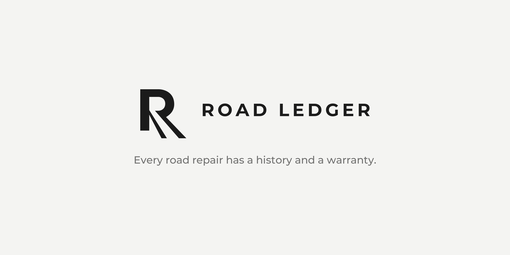

<p align="center">
  
</p>

<p align="center"><a href="README.md">English</a> | Українська</p>

<p align="center">
  <b>Фото ями → дефект → договір у Prozorro → чи діє гарантія підрядника</b><br>
  Chernivtsi Open Data Hackathon 3.0
</p>

---

## Проблема

Вулиці в Чернівцях ремонтують, а за рік-два на тих самих місцях знову з'являються ями й тріщини. Підрядник зазвичай дає гарантію на виконані роботи, але про неї ніхто не згадує. У результаті місто платить за ремонт удруге, хоча мало б вимагати гарантійного ремонту за рахунок підрядника.

**Реальний кейс: вулиця Кармелюка, Чернівці.** У 2020–2021 роках вулицю капітально відремонтували за понад 47 млн грн, з 10-річною гарантією. У 2024 році просіли люки. Підрядник гарантійних робіт не виконав, тож ремонт зробило комунальне підприємство за кошти міського бюджету. ([Суспільне Чернівці, липень 2024](https://suspilne.media/chernivtsi/802107-dilanki-poblizu-lukiv-na-vulici-karmeluka-u-cernivcah-vidremontuvali-ne-za-garantieu-pisla-kapremontu-comu/))

Дані для перевірки вже відкриті: усі договори на ремонт доріг є в **Prozorro**. Проблема в тому, що ніхто не зіставляє конкретну яму з конкретним договором.

## Як працює

Мешканець фотографує дефект, а Road Ledger відповідає, чи ця ділянка ще на гарантії і хто за неї відповідає.

```
 Фото + геолокація
        │
        ▼
 ┌──────────────────────┐   ┌──────────────────────┐   ┌──────────────────────┐
 │ 1. Розпізнавання     │   │ 2. База договорів    │   │ 3. Матчинг           │
 │ YOLO11s знаходить    │──▶│ Prozorro: ремонти    │──▶│ вулиця + дата +      │
 │ crack / patching /   │   │ доріг Чернівців,     │   │ строк гарантії →     │
 │ pothole              │   │ вулиці, підрядники,  │   │ «гарантія діє до …,  │
 │                      │   │ строки гарантії      │   │  підрядник …»        │
 └──────────────────────┘   └──────────────────────┘   └──────────────────────┘
```

1. **Розпізнавання.** CV-модель (YOLO11s) знаходить на фото дефект покриття і визначає його тип.
2. **База договорів.** Договори на ремонт доріг з Prozorro зведені в таблицю: вулиця, дата завершення робіт, підрядник, гарантійний строк.
3. **Матчинг.** За геолокацією фото система визначає вулицю, знаходить останній ремонт і показує, чи гарантія ще діє.

## Статус

| Компонент | Статус | Де |
|---|---|---|
| CV-модель (YOLO11s, 3 класи) | Натренована, перевірена на test | [`model/`](model/README.uk.md) |
| Датасет | Зібраний (Roboflow Universe) | [`data/`](data/README.uk.md) |
| База договорів Prozorro | В роботі | [`ledger/`](ledger/README.uk.md) |
| Матчинг фото ↔ договір | В роботі | [`ledger/`](ledger/README.uk.md) |
| Додаток (PWA) | В роботі | [`app/`](app/README.uk.md) |

Результати моделі на test-вибірці (391 фото): **mAP50 = 0.784**, P = 0.808, R = 0.712. Деталі в [`model/README.uk.md`](model/README.uk.md).

## Структура репозиторію

```
road-ledger/
├── README.md            ← англійська версія (README.uk.md — ви тут)
├── requirements.txt     ← залежності (ultralytics, roboflow)
├── assets/
│   └── brand/           ← логотипи і банер (SVG, PNG)
├── model/
│   ├── README.md        ← метрики, параметри тренування, інференс
│   ├── weights/
│   │   └── best.pt      ← натреновані ваги YOLO11s
│   ├── notebooks/
│   │   └── train.ipynb  ← блокнот тренування (Colab)
│   └── images/
│       ├── train/       ← криві навчання
│       └── test/        ← графіки й передбачення на test-вибірці
├── data/
│   └── README.md        ← джерело датасету, ліцензія, класи, відтворення
├── ledger/
│   └── README.md        ← база договорів Prozorro і матчинг (в роботі)
└── app/
    └── README.md        ← PWA для мешканців (в роботі)
```

Кожен README має українську версію поруч (`README.uk.md`).

## Швидкий старт

```bash
pip install -r requirements.txt
```

Як запустити модель, описано в [`model/README.uk.md`](model/README.uk.md#інференс).

---

<p align="center"><a href="README.md">English</a> | Українська</p>
