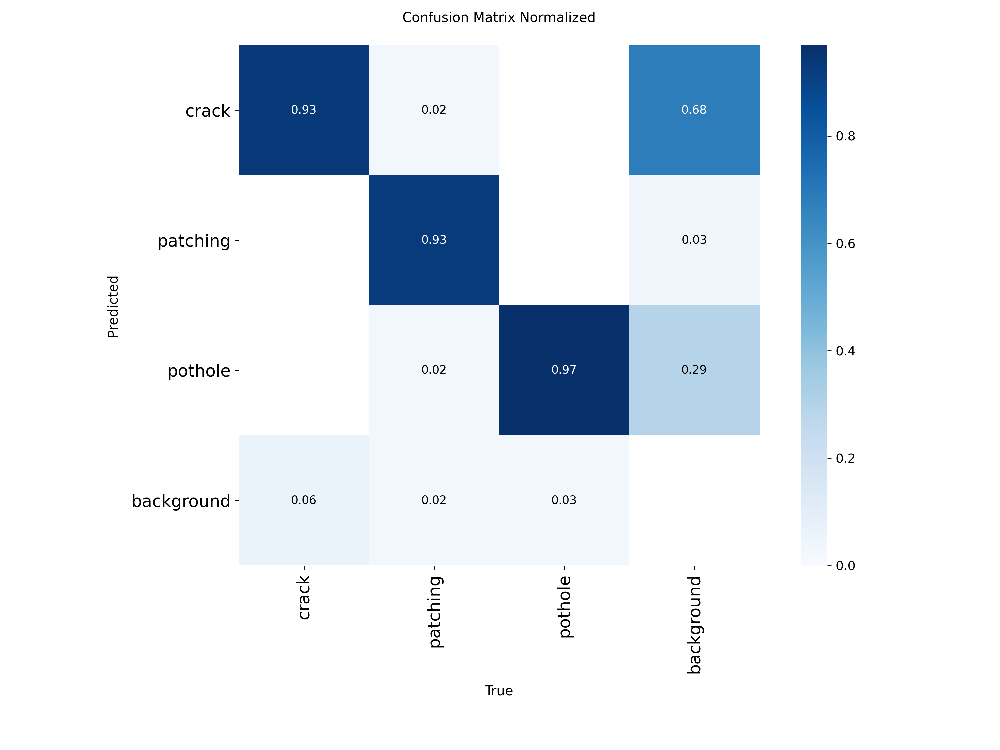

# Модель розпізнавання дефектів

YOLO11s для детекції трьох типів дефектів дорожнього покриття: **crack** (тріщина), **patching** (латка), **pothole** (яма).

## Метрики на test-вибірці (391 фото)

| Клас | P | R | mAP50 | mAP50-95 |
|---|---|---|---|---|
| all | 0.808 | 0.712 | 0.784 | 0.541 |
| crack | 0.742 | 0.566 | 0.668 | 0.410 |
| patching | 0.857 | 0.739 | 0.823 | 0.647 |
| pothole | 0.825 | 0.831 | 0.862 | 0.565 |

Найкраще модель знаходить ями (pothole), найгірше тріщини (crack). Тріщини тонкі й різноманітні за формою, до того ж у цей клас зведено 4 вихідні типи тріщин (див. [`data/README.md`](../data/README.md)).

## Параметри тренування

| Параметр | Значення |
|---|---|
| Модель | `yolo11s` |
| Epochs | 50 |
| imgsz | 640 |
| batch | 16 |
| Датасет | 3 912 фото, спліт 70 / 20 / 10 (train / val / test) |
| Препроцесинг | Auto-Orient, Resize 640 |
| Аугментації | без аугментацій |

## Графіки

<!-- TODO: додати results.png (криві навчання), коли буде вивантажено з Colab -->

**Precision-Recall крива**


**Confusion matrix (нормалізована)**



Інші криві (F1, P, R) лежать у [`images/`](images/).

## Інференс

```python
from ultralytics import YOLO

model = YOLO("best.pt")
results = model.predict("pothole.jpg", imgsz=640, conf=0.25)

for box in results[0].boxes:
    cls = results[0].names[int(box.cls)]
    print(f"{cls}: {float(box.conf):.2f}, bbox={box.xyxy[0].tolist()}")

results[0].save("pothole_pred.jpg")  # фото з намальованими рамками
```

> Ваги `best.pt` ще не додані в репозиторій.
