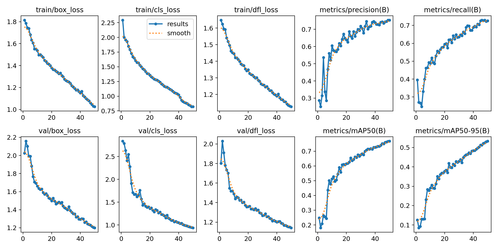
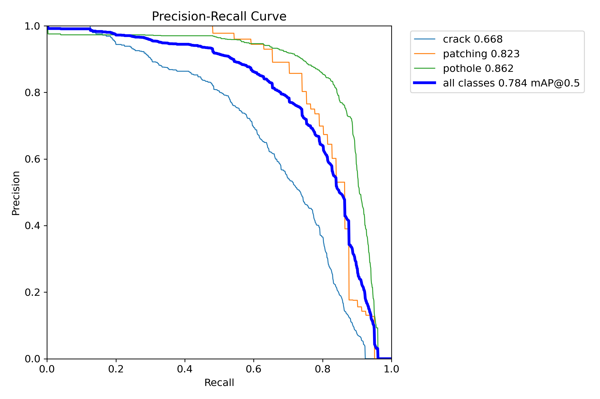

English | [Українська](README.uk.md)

# Defect detection model

YOLO11s trained to detect three types of pavement defects: **crack**, **patching**, and **pothole**.

## Test set metrics (391 images)

| Class | P | R | mAP50 | mAP50-95 |
|---|---|---|---|---|
| all | 0.808 | 0.712 | 0.784 | 0.541 |
| crack | 0.742 | 0.566 | 0.668 | 0.410 |
| patching | 0.857 | 0.739 | 0.823 | 0.647 |
| pothole | 0.825 | 0.831 | 0.862 | 0.565 |

Potholes are detected best and cracks worst. Cracks are thin and vary a lot in shape, and this class also merges 4 crack types from the source dataset (see [`data/README.md`](../data/README.md)).

## Training setup

| Parameter | Value |
|---|---|
| Model | `yolo11s` |
| Epochs | 50 |
| imgsz | 640 |
| batch | 16 |
| Dataset | 3,912 images, 70 / 20 / 10 split (train / val / test) |
| Preprocessing | Auto-Orient, Resize 640×640 (stretch) |
| Augmentation | none |

## Plots

**Training**



**Test: precision-recall curve**



More plots in [`images/test/`](images/test/): confusion matrix, F1/P/R curves, sample predictions.

## Inference

```python
from ultralytics import YOLO

model = YOLO("model/weights/best.pt")
results = model.predict("pothole.jpg", imgsz=640, conf=0.25)

for box in results[0].boxes:
    cls = results[0].names[int(box.cls)]
    print(f"{cls}: {float(box.conf):.2f}, bbox={box.xyxy[0].tolist()}")

results[0].save("pothole_pred.jpg")  # image with boxes drawn on it
```

To reproduce training, use [`notebooks/train.ipynb`](notebooks/train.ipynb). Set the `ROBOFLOW_API_KEY` environment variable first, and see [`data/README.md`](../data/README.md#reproducing-the-dataset) for how to prepare the dataset.

---

English | [Українська](README.uk.md)
